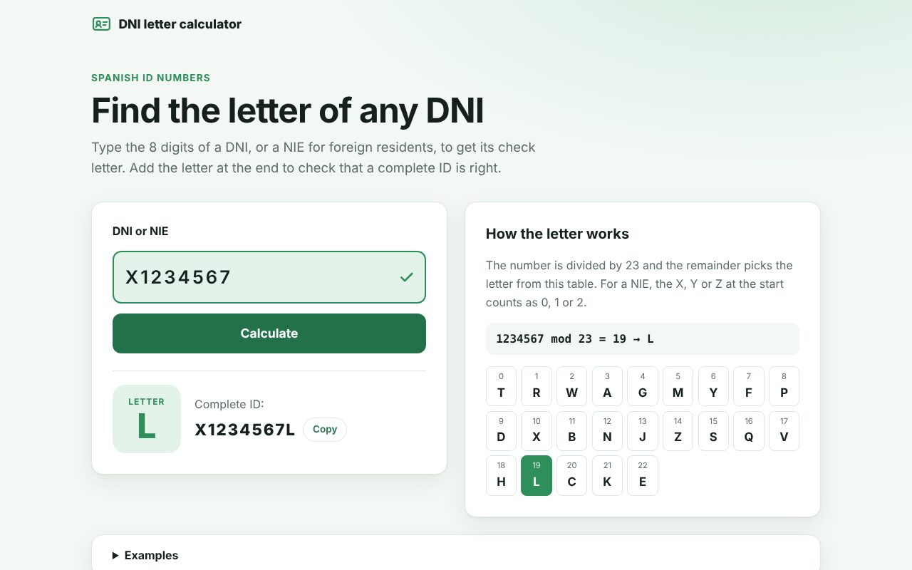
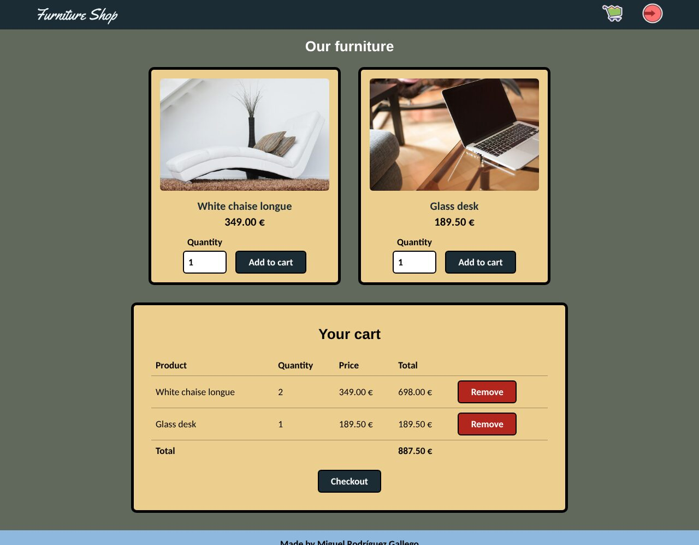

# Web projects: HTML, CSS, JavaScript, PHP and MySQL

[](https://github.com/miguelrg14/Web-Fundamentals_HTML-CSS-JS-PHP/actions/workflows/ci.yml)

Coursework from the web development subjects of my Computer Science & Video Game Engineering degree at ESNE,
refactored into one repository: three static sites you can **open in the browser right now**, and an online
**furniture shop in PHP and MySQL** with sign-up, login, a shopping cart and orders.

**▶ Live demos: [miguelrg14.github.io/Web-Fundamentals_HTML-CSS-JS-PHP](https://miguelrg14.github.io/Web-Fundamentals_HTML-CSS-JS-PHP/)**

| Project | What it shows | Try it |
|---|---|---|
| [Costa Verde](sites/costa-verde) | Two-page tourism site: semantic HTML, fixed menu, CSS animations, in-page navigation | [Live](https://miguelrg14.github.io/Web-Fundamentals_HTML-CSS-JS-PHP/costa-verde/) |
| [Personal site](sites/personal-site) | Portfolio with my art, programming projects and music; audio, video and a contact form | [Live](https://miguelrg14.github.io/Web-Fundamentals_HTML-CSS-JS-PHP/personal-site/) |
| [DNI letter calculator](sites/dni-validator) | JavaScript form validation and DOM updates; works out and checks Spanish DNI/NIE letters | [Live](https://miguelrg14.github.io/Web-Fundamentals_HTML-CSS-JS-PHP/dni-validator/) |
| [Furniture shop](furniture-shop) | PHP + MySQL: accounts, sessions, cart and orders, built with security in mind | [Run with Docker](#furniture-shop-php--mysql) |

## Screenshots

| Costa Verde | Personal site |
|---|---|
|  |  |

| DNI letter calculator | Furniture shop |
|---|---|
|  |  |

## Static sites (HTML, CSS, JavaScript)

The sites in [`sites/`](sites) are plain HTML, CSS and JavaScript with no build step: open any `index.html`
in a browser, or visit the live versions, which GitHub Pages publishes from `main` on every push.

- **Valid, accessible HTML**: semantic elements (`header`, `nav`, `main`, `article`, `figure`), alt text on every
  image, labelled form fields, and the HTML is checked with [html-validate](https://html-validate.org) in CI.
- **Responsive CSS** with flexbox and grid, `clamp()` font sizes, media queries and keyframe animations.
- **Fonts served from the site itself**, so pages load no third-party resources.
- **DNI letter calculator**: the logic ([`dni.js`](sites/dni-validator/js/dni.js)) is separate from the page
  ([`app.js`](sites/dni-validator/js/app.js)) and covered by [unit tests](tests/dni.test.js). Besides working out
  the letter of a DNI it validates complete IDs (`12345678Z`), accepts spaces, dots and dashes, and supports
  NIEs (`X1234567L`).

```bash
npm install
npm test           # JavaScript unit tests (node:test)
npm run validate   # HTML validation
```

## Furniture shop (PHP + MySQL)

A small online shop: visitors sign up or log in, add furniture to the cart and check out. Orders are stored
in MySQL and each user can see their own.

```bash
cd furniture-shop
docker compose up --build    # then open http://localhost:8080
```

Docker Compose starts MySQL 8.4, creates the tables from [`database/schema.sql`](furniture-shop/database/schema.sql)
and serves the shop with PHP 8.3 and Apache. `docker compose down -v` deletes the data.

### How it's built

```
furniture-shop/
├── public/            web root: only these files can be requested
│   ├── login.php, register.php, products.php, thanks.php, logout.php
│   └── css/, fonts/, images/
├── src/               application code, outside the web root
│   ├── UserRepository.php      sign-up and login
│   ├── ProductRepository.php   the catalog
│   ├── Cart.php, CartLine.php  the cart kept in the session
│   ├── OrderRepository.php     checkout and order history
│   ├── Csrf.php, View.php      form tokens and HTML escaping
│   └── bootstrap.php, layout.php
├── database/schema.sql
├── tests/             PHPUnit unit and database tests + an end-to-end HTTP test
└── Dockerfile, compose.yaml
```

### Security

The first version of this shop was vulnerable in several ways; this one fixes them:

| Risk | Protection |
|---|---|
| SQL injection | Every query is a prepared statement (PDO, no emulation); user input never becomes SQL. |
| Stolen passwords | Passwords are stored with `password_hash()` (bcrypt) and checked with `password_verify()`; old hashes are upgraded on login. |
| Changing the price in the browser | The cart only stores product ids and quantities; prices always come from the database. |
| XSS | All output goes through `htmlspecialchars()`, plus a strict Content-Security-Policy. |
| CSRF | Every form carries a random per-session token checked with `hash_equals()`; logout is a POST too. |
| Session theft and fixation | Session cookies are `HttpOnly` and `SameSite=Lax`, and the session id changes on login and logout. |
| Pages without logging in | The cart, checkout and order pages require a login; users can only see their own orders. |
| Finding out who has an account | Login gives the same message, and takes the same time, for unknown emails and wrong passwords. |
| Credentials in the code | The database connection is configured with environment variables. |

### Data and transactions

- Prices are stored in whole cents (`INT`), so totals have no floating-point rounding errors.
- Checkout saves the order and all its lines in a **transaction**: if any line fails, nothing is saved.
- Order lines keep the unit price at the time of purchase, so later price changes don't rewrite old orders.
- Constraints in the database back up the code: unique emails, foreign keys, and `CHECK` rules on prices and quantities.
- Every change to the cart is a POST followed by a redirect, so reloading the page never repeats an action.

### Tests

```bash
cd furniture-shop
composer install
vendor/bin/phpunit                      # unit tests; database tests run when DB_HOST etc. are set
tests/smoke.sh http://localhost:8080    # end-to-end checks against the running shop
```

- **Unit tests**: cart rules, CSRF tokens, HTML escaping and money formatting.
- **Database tests** against a real MySQL: sign-up and login, duplicate emails, password hashing and rehashing,
  SQL injection attempts, orders, transaction rollback and the database constraints.
- **End-to-end test** ([`smoke.sh`](furniture-shop/tests/smoke.sh)): drives the shop over HTTP like a browser
  and checks 30+ behaviours, including tampered prices, missing CSRF tokens, SQL injection, XSS, other users'
  orders and the security headers.

## Continuous integration

[GitHub Actions](.github/workflows/ci.yml) runs on every push:

1. **Static sites**: HTML validation and JavaScript tests.
2. **Shop**: PHP syntax check, PHPUnit against a MySQL service, the end-to-end test against the PHP server,
   and validation of the HTML the shop generates.
3. **Docker**: builds the image, starts the whole stack with Docker Compose and runs the end-to-end test against it.

[Another workflow](.github/workflows/pages.yml) publishes `sites/` to GitHub Pages.

## Credits

- Fonts: [Montserrat](https://github.com/JulietaUla/Montserrat) (SIL Open Font License) and Yellowtail
  (Apache License 2.0), from [Fontsource](https://fontsource.org); their licences are next to the font files.
- The artwork, music and screenshots on the personal site are my own.

## License

[MIT](LICENSE) © Miguel Rodríguez Gallego
